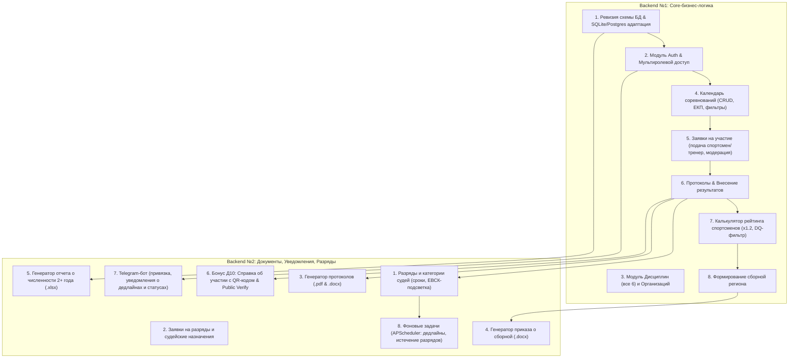

# План разработки Backend: Единая цифровая платформа ФСП Оренбургской области
*(Совмещенная роль: Backend №1 Core-логика + Backend №2 Документы/Интеграции)*

---

## 1. Архитектурный обзор и текущее состояние

### 1.1. Текущий статус кодовой базы
- **Стек**: FastAPI, SQLAlchemy 2.0 (async), Pydantic v2, PostgreSQL/SQLite fallback, `reportlab` (PDF), `python-docx` (Word), `openpyxl` (Excel), `aiogram 3.x` (Telegram), `qrcode`.
- **Модели данных (`app/models`)**: Базовые сущности созданы (`user`, `discipline`, `competition`, `application`, `result`, `rank`, `judge`, `rating`, `notification`, `audit`, `certificate`, `coach_athlete`), но требуют ревизии связей и добавления вспомогательных полей (возрастные категории, калькуляция баллов, SQLite-совместимость типов).
- **Отсутствующие компоненты**:
  - Точка входа приложения (`app/main.py`), CORS, обработка ошибок, auth middleware/deps.
  - Pydantic-схемы валидации (`app/schemas/`).
  - Сервисный слой бизнес-логики (`app/services/`): калькулятор рейтинга, ЕВСК-валидатор, генераторы документов, сервис уведомлений.
  - Маршруты API (`app/api/v1/`): ролевая модель, календарь, заявки, протоколы, разряды, судьи, рейтинг, отчеты, публичная верификация.
  - Telegram-бот (`bot/`): привязка аккаунтов, polling/webhook, команды, отправка нотификаций.
  - Модуль генерации фиктивных демо-данных (сиды для демонстрации на чекпоинтах).

---

## 2. Детальная декомпозиция задач по ролям

---

## 3. Пошаговый план разработки

### Этап 1: Инфраструктура, БД и Аутентификация с мультиролевостью
1. **Поддержка SQLite + PostgreSQL**:
   - Настройка `database.py` и `config.py`: если Postgres недоступен, автоматически использовать `sqlite+aiosqlite:///fsp.db` (или настраиваемый путь) с корректной конвертацией `UUID` и `JSONB` для бесшовного запуска локально без сторонних сервисов.
2. **Инициализация 6 дисциплин ФСП**:
   - `ALGO` — Программирование алгоритмическое
   - `PROD` — Программирование продуктовое
   - `SEC` — Программирование систем информационной безопасности
   - `AI` — Программирование систем искусственного интеллекта
   - `ROBO` — Программирование робототехники
   - `DRONE` — Программирование беспилотных авиационных систем (БАС)
3. **Аутентификация и мультиролевая модель**:
   - Пользователь имеет один логин/пароль и список ролей: `[athlete, coach, judge, federation]`.
   - Заголовок `X-Active-Role` или параметр токена для мгновенного переключения активной роли без повторной авторизации.
   - FastAPI Depends: `get_current_user`, `require_role(["federation", "coach", ...])`.

### Этап 2: Core-логика соревнований и заявок (Человек 2)
1. **Справочники и календарь**:
   - Типы соревнований (Чемпионат, Первенство, Кубок и др. — с возможностью расширения).
   - Календарные планы (ЕКП Минспорта РФ, план Оренбургской области + номер в плане).
   - CRUD соревнований с полями: дисциплина, даты, формат (очное/онлайн/смешанное), уровень (Чемпионат РФ, Первенство РФ, Межрегиональное, Региональное), статус (черновик, открыт прием, закрыт прием, идет, завершено), возрастная группа, регламент/положение.
   - Фильтрация: по дисциплине, возрастной группе спортсмена, датам, статусу.
2. **Заявки на участие**:
   - Спортсмен подает сам (с автоматической проверкой возраста).
   - Тренер подает за своих закрепленных спортсменов (`coach_athletes`).
   - Валидация дедлайна регистрации (`registration_deadline`).
   - Модерация заявки федерацией: перевод статусов (`approved`, `rejected` с указанием причины).
3. **Результаты и протокол**:
   - Автоматическое включение одобренных заявок в стартовый список.
   - Ввод результатов: место, баллы/время, статус (`normal`, `disqualified`, `dns`, `dnf`), комментарий.
   - Ранжирование участников.
   - Автоматическое сохранение в историю выступлений каждого спортсмена.

### Этап 3: Калькулятор рейтинга и формирование сборной (Человек 2)
1. **Калькулятор баллов за сезон**:
   - Базовая таблица начисления очков в зависимости от уровня и занятого места:
     * Чемпионат РФ: 1 место = 100, 2 место = 80, 3 место = 60
     * Первенство РФ: 1 место = 80, 2 место = 60, 3 место = 40
     * Межрегиональные: 1 место = 60, 2 место = 45, 3 место = 30
     * Региональные: 1 место = 40, 2 место = 30, 3 место = 20
     *(настраивается в `rating_settings`)*.
   - Суммирование очков по дисциплине за сезон.
   - **Коэффициент стабильности $\times 1.2$**: автоматическое применение, если у спортсмена $\ge 2$ призовых мест (1-3) за сезон.
   - **Фильтр дисквалификации**: спортсмены с действующей дисквалификацией (`is_disqualified == True` или `disqualification_until >= today`) исключаются из рейтинга.
   - Прозрачный вывод расчета: детализация каждого старта, начисленные очки, примененный коэффициент.
2. **Формирование сборной региона**:
   - Фильтрация рейтинга по возрастной группе и дисциплине.
   - Отбор кандидатов в основной и резервный состав.
   - Сохранение утвержденного ростера (`team_rosters`, `team_roster_members`).

### Этап 4: Разряды, судейство и ЕВСК (Человек 3)
1. **Разряды спортсменов**:
   - 3 юношеский, 2 юношеский, 1 юношеский, 3, 2, 1, КМС, МС, МСМК.
   - Сроки действия: 2 года (массовые/юношеские), 3 года (КМС), бессрочно (МС/МСМК).
   - Заявки на разряд от тренера или спортсмена (с привязкой к протоколу и занятому месту).
   - Подтверждение федерацией с номером и датой приказа.
   - **Подсветка ЕВСК**: алгоритм, сравнивающий статус соревнования и занятое место, выдающий флаг `evsk_eligible_rank`.
2. **Судейские категории и назначения**:
   - Категории: 3, 2, 1, Всероссийская, Международная.
   - Учет сроков действия судейских категорий.
   - Назначение судей на соревнования с указанием должности (Главный судья, Главный секретарь, Судья линии).
   - История судейства в профиле судьи.

### Этап 5: Генерация документов и отчетов (Человек 3)
1. **Протокол соревнований (`.docx` и `.pdf`)**:
   - Официальный титульный лист ФСП Оренбургской области.
   - Место, дата, дисциплина, уровень, главная судейская коллегия.
   - Полная ранжированная таблица участников с результатами и присвоенными баллами.
2. **Проект приказа о сборной региона (`.docx`)**:
   - Приказ об утверждении списка кандидатов в спортивную сборную команду Оренбургской области по спортивному программированию.
   - Таблица основного и резервного составов (ФИО, дата рождения, разряд, организация, город, тренер).
3. **Отчет о численности с динамикой по годам (`.xlsx`)**:
   - Генерация через `openpyxl`.
   - Динамика не менее 2 лет.
   - Листы/разрезы: по организациям, муниципалитетам, 6 дисциплинам, возрастным категориям.
   - Красивые стили, формулы сумм, процент прироста.
4. **Бонус Д10: Справка об участии с QR-кодом**:
   - Генерация справки в `.pdf` через ReportLab.
   - Генерация QR-кода со ссылкой вида `http://<domain>/verify/<certificate_number>`.
   - Endpoint публичной проверки подлинности справки: выдает валидность, ФИО спортсмена, статус участия, место, дату и соревнование.

### Этап 6: Уведомления, Telegram-бот и фоновые задачи (Человек 3)
1. **Telegram-бот (на aiogram 3.x)**:
   - Команда `/start` и `/link <токен>`: связывание Telegram chat_id с профилем пользователя платформы.
   - Меню статуса: мои заявки, мои соревнования, срок действия разряда.
2. **Служба отправки уведомлений (`NotificationService`)**:
   - Одновременное создание записи в БД (`notifications`) и отправка пуша в Telegram через бота.
   - События:
     * Открытие регистрации на соревнование;
     * Одобрение / отклонение заявки на соревнование;
     * Публикация официального протокола соревнований;
     * Смена статуса заявки на разряд / категорию;
3. **Фоновый планировщик (APScheduler)**:
   - Проверка дедлайнов окончания регистрации (за 3 дня, за 24 часа).
   - Контроль истечения разрядов и судейских категорий (за 30 дней и за 7 дней).
   - Напоминание о губернаторских премиях (до 1 февраля).

### Этап 7: Демо-данные (Seed Data) и соответствие чекпоинтам
1. **Скрипт наполнения (`seed_demo_data.py`)**:
   - Полный набор 6 дисциплин.
   - 3 типовые организации (ОГУ, Лицей №1, IT-Куб Оренбург).
   - 10+ пользователей с разными ролями (Администратор Федерации, 2 Тренера, 6 Спортсменов разных возрастов, 2 Судьи).
   - 4 соревнования разного уровня (Чемпионат РФ, Первенство ПФО, Чемпионат Оренбургской области, Кубок губернатора).
   - Готовые протоколы с результатами, демонстрирующие применение коэффициента $\times 1.2$ и отсечение дисквалифицированного спортсмена.
   - Разряды с разными сроками (активные, истекающие).
2. **Готовность к Чекпоинту №2 (Сквозной сценарий)**:
   - *Сквозной сценарий:* Вход как федерация $\rightarrow$ создание турнира $\rightarrow$ вход как спортсмен/тренер $\rightarrow$ подача заявки $\rightarrow$ одобрение федерацией $\rightarrow$ внесение результатов $\rightarrow$ генерация протокола $\rightarrow$ пересчет рейтинга $\rightarrow$ генерация QR-справки.

---

## 4. Спецификация ключевых API Endpoints

| Модуль | Метод & Путь | Описание | Роли |
|---|---|---|---|
| **Auth** | `POST /api/v1/auth/login` | Вход, выдача JWT токена | Все |
| **Auth** | `GET /api/v1/auth/me` | Данные текущего пользователя и его роли | Все |
| **Disciplines** | `GET /api/v1/disciplines` | Список всех 6 дисциплин вида спорта | Все |
| **Competitions** | `GET /api/v1/competitions` | Календарь с фильтрацией (дисциплина, возраст, статус) | Все |
| **Competitions** | `POST /api/v1/competitions` | Создание соревнования | Federation |
| **Competitions** | `PUT /api/v1/competitions/{id}` | Редактирование, смена статуса | Federation |
| **Applications** | `POST /api/v1/competitions/{id}/apply` | Подача заявки (спортсмен за себя, тренер за подопечных) | Athlete, Coach |
| **Applications** | `GET /api/v1/competitions/{id}/applications` | Список заявок со статусами | Federation, Coach |
| **Applications** | `PATCH /api/v1/applications/{id}/status` | Одобрение / отклонение заявки | Federation |
| **Results** | `POST /api/v1/competitions/{id}/results` | Внесение результатов соревнований | Federation |
| **Results** | `GET /api/v1/competitions/{id}/protocol` | Получение протокола | Все |
| **Rating** | `GET /api/v1/rating/athletes` | Рейтинг с расчетом баллов, $\times 1.2$ и фильтрами | Все |
| **Roster** | `POST /api/v1/rating/roster` | Формирование состава сборной региона | Federation |
| **Ranks** | `GET /api/v1/ranks/expiring` | Список истекающих разрядов | Federation, Coach |
| **Ranks** | `POST /api/v1/ranks/apply` | Заявка на разряд по итогам соревнования | Athlete, Coach |
| **Documents** | `GET /api/v1/documents/protocol/{comp_id}/pdf` | Скачать протокол в PDF | Все |
| **Documents** | `GET /api/v1/documents/protocol/{comp_id}/docx` | Скачать протокол в Word | Все |
| **Documents** | `GET /api/v1/documents/roster/{roster_id}/docx` | Проект приказа о сборной в Word | Federation |
| **Documents** | `GET /api/v1/documents/statistics/xlsx` | Отчет о численности занимающихся в Excel | Federation |
| **Verify (Д10)** | `POST /api/v1/documents/certificate/{result_id}` | Выпуск справки с QR-кодом | Athlete, Coach |
| **Verify (Д10)** | `GET /api/v1/verify/{certificate_number}` | Публичная страница/API верификации справки | Публично |
| **Telegram** | `POST /api/v1/notifications/telegram/link-code` | Генерация кода привязки Telegram | Все |

---

## 5. График реализации (Спринты разработки)

- **Блок 1 (Фундамент)**: `main.py`, CORS, SQLite/Postgres DB setup, JWT Auth с ролями, сидирование 6 дисциплин.
- **Блок 2 (Соревнования и заявки)**: CRUD турниров, модерация заявок, ввод результатов, протокол.
- **Блок 3 (Рейтинг и сборная)**: Калькулятор очков, множитель $\times 1.2$, отсечение дисквалифицированных, утверждение сборной.
- **Блок 4 (Разряды и судьи)**: ЕВСК-валидатор, учет сроков, подача заявок на разряды, судейские коллегии.
- **Блок 5 (Генераторы файлов и Д10)**: Шаблоны `.docx`, `.pdf`, `.xlsx`, генерация QR и публичный endpoint проверки.
- **Блок 6 (Уведомления и Telegram-бот)**: Бот на aiogram 3, привязка, рассылка уведомлений.
- **Блок 7 (Демо-данные и тестирование)**: Скрипт `seed_data.py`, тестирование всех сценариев хакатона.
